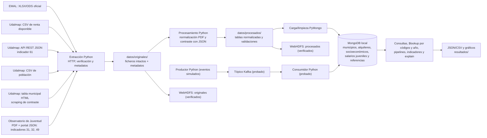

# Arquitectura

## Decisiones de diseño

- Los ficheros descargados se guardan sin modificar bajo `datos/originales/`; los resultados normalizados van por separado a `datos/procesados/`. El scraping HTML es una comprobación independiente del CSV de renta y no duplica observaciones en MongoDB.
- La clave común será el código municipal oficial de cinco caracteres, como texto. Los nombres se conservan para lectura, no como clave de unión.
- El salario juvenil se guarda una vez por periodo y territorio histórico en `salarios_juveniles`; no se replica como si fuese una observación salarial municipal. Los datos marginales de edad/sexo de Euskadi conservan `territory_code: null`.
- La tabla principal enlaza el salario al municipio mediante el código territorial (`01`, `48`, `20`) y el año 2024. Las referencias OVJ de esfuerzo de alquiler y renta personal juvenil se guardan separadas en `referencias_juventud`.
- El PDF de juventud se descarga intacto, se verifica por SHA-256 y se procesa con `pypdf`. Las respuestas JSON del portal estadístico oficial se conservan por separado y validan valores publicados; no duplican observaciones en MongoDB. La salida normalizada se mantiene en `datos/procesados/ingresos/`.
- El portal usa un endpoint JSON público pero no documentado como API independiente. El descargador obtiene los filtros de la página oficial y valida valores conocidos; como el servicio puede cambiar y presenta márgenes distintos en algunos indicadores, el PDF permanece como fuente archivística principal.
- El alquiler solo tiene cobertura municipal para capitales y municipios de más de 5.000 habitantes; el análisis no extrapolará a otros municipios.
- Las colecciones de MongoDB se separarán por entidad/dominio y se relacionarán por código municipal y periodo. Los cambios de límites y la procedencia se guardarán de forma explícita.
- Kafka recibió dos eventos de prueba simulados que se persistieron en `anuncios_stream`; no son anuncios reales y no alimentan los indicadores. WebHDFS recibió originales y procesados; se verificaron las transferencias y una recuperación por tamaño/SHA-256. Las evidencias se describen en [integraciones](integraciones.md).

## Estructura

- `datos/originales/`: una subcarpeta y metadatos por fuente.
- `datos/procesados/`: datos homogéneos por dominio.
- `scripts/`: extracción, procesamiento, MongoDB, Kafka, HDFS y análisis.
- `resultados/`: tablas, gráficos e indicadores generados.
- `documentacion/`: fuentes, arquitectura, metodología, resultados e instrucciones de demostración.
- `logs/`: registros de ejecuciones locales.
